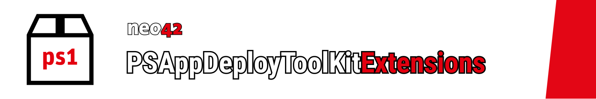



## 👋 Introduction

The neo42 PSAppDeployToolkit Extensions integrate with and extend a globally respected and rigorously tested deployment framework. It combines the PSAppDeployToolkit with the vision of neo42 to provide an easy-to-use, advanced packaging solution.

🧩 neo42 GmbH makes use of the extensions in this repository to provide multiple services:
- [Application Package Depot](https://neo42.de/application-package-depot) - Select and automate from a large amount of packaged software
- [Package Recorder PRO](https://neo42.de/produkte/package-recorder) - Advanced and easy-to-use packaging tool
- [Providing of custom software packages](https://neo42.de/dienstleistungen/softwarepaketierung) - Software packages tailored to your needs

🔓 By providing public access, we hope that others will benefit from it and help to improve this solution.

## 💭 Why use the neo42 Extensions

### 📈 Configuration based installers

__🎚️ No code approach to writing new packages__

Don't want to write new code for every simple package? Make use of our Deploy-Application.ps1 which can be controlled solely by its corresponding neo42PackageConfig.json. The standardized installation sequence remains unchanged for each package!

_The included schema for the json file and examples will help you write your first package in no time._

__🎨 Custom* functions__

You are not limited to the values contained within the configuration file: You can also write customizations in the intended Custom* functions without losing the framework we provide. The Custom* functions offer many different entry points to intervene in the deployment process and perform individual actions for each package if required.

__⛓️ Automation first__

In addition to the neo42PackageConfig.json file, which is very easy to change programmatically, we also made sure that automatic updates are possible in many other aspects. For example, in this [script](https://github.com/neo42-GmbH/ManagementService-PowerShell/blob/master/Pipelines/Add-ContentToCustomFunction.ps1) we demonstrated how to inject code into the aforementioned Custom* functions. Your own product-specific code can be automatically transferred to new packages at any time!

### ✨ New functionalities

__🪄 The neo42 Extensions offer dozens of new functions__

* They simplify interacting with complex data types such as XML
* Allow you to access data that is not supported by default in PowerShell 5.1 like INI, JsonC and others.
* Quickly access device information like process trees or drive information
* Make interacting with system security-related functions easy. For example, setting ACLs in simple but powerful functions.
* They extend PSADT functions with more functionality or altered defaults that are compatible with neo42 packages
* Make use of observer functions that handle waiting for processes, files, registry keys and others easy

_All functions are tested to work in different deployment system contexts such as Empirum, SCCM, Intune or Workspace One._

__💡 Integrated installer handling__

Based on our long experience, we have been able to integrate the silent parameters and handling for the most common installer types into the extension. In most cases, no further parameters or code adaptations are necessary for the following installer types:

* MSI
* InnoSetup
* BitRock
* Nullsoft
* Burn
* AppX

_Apart from these installer types, any other installer can be handled via the predefined fields in the configuration file._

## 🛠️ Build instructions

_Note: We always recommend obtaining the latest production release from the [releases page](https://github.com/neo42-GmbH/PSAppDeployToolKitExtensions/releases/latest)._

### 🔎 Requirements

* PSAppDeployToolkit 4.1.8 module
* PowerShell 5.1 and PowerShell 7.6 or later
* .NET Framework 4.7.2 SDK
* .NET 8 SDK

### 🌤️ Recommended Build Environment

* [Requirements](#-requirements) installed
* [Visual Studio Code](#-links) - For predefined development environment
* [PowerShell Core](#-links) - For cross edition tests
* PowerShell modules installed (for both PowerShell editions):
  * [PSScriptAnalyzer](#-links) `>= 1.25` - For code analysis and the migration tool
  * [Pester](#-links) `>= 5.6` - For testing the project

### 📋 Steps

* Clone or download the content of this repository.
* Build the project by one of the following methods:
  * Using the predefined VSCode build tasks _(Recommended)_
  * Walking through the manual steps, supported by scripts:
    1. Run `.tools\Install-RequiredModule.ps1` to download the required [PSADT dependencies](#-requirements).
    2. Run `.tools\Export-Module.ps1`.
    3. Run `.tools\Invoke-Compile.ps1` or use the `dotnet publish` command for `src\solutions`.

## 📚 Documentation
For detailed documentation of the neo42 PSADT Extensions, visit our [neo42 PSADT Extensions Wiki](https://portal.neo42.de/Documentation/66d825612756cd61dea8ba8c).

## 📜 License

The content of this repository is licensed under the [GNU Lesser General Public License](https://www.gnu.org/licenses/licenses.html) version 3, or any later version. You can find a copy of the license at the root of this repository. You are free to use, alter and share the contents as you wish as long as it complies with the aforementioned license.

This code is distributed WITHOUT ANY WARRANTY; without even the implied warranty of MERCHANTABILITY or FITNESS FOR A PARTICULAR PURPOSE. See the GNU Lesser General Public License for more details.

## 🔗 Links

* [PSAppDeployToolkit Project](https://github.com/PSAppDeployToolkit/PSAppDeployToolkit)
* [Visual Studio Code](https://code.visualstudio.com/)
* [PowerShell Core](https://learn.microsoft.com/de-de/powershell/module/microsoft.powershell.core)
* [PSScriptAnalyzer Module](https://learn.microsoft.com/de-de/powershell/module/psscriptanalyzer)
* [Pester Module](https://pester.dev/)
